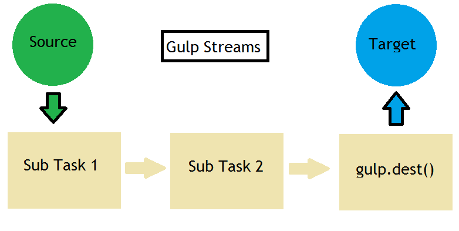
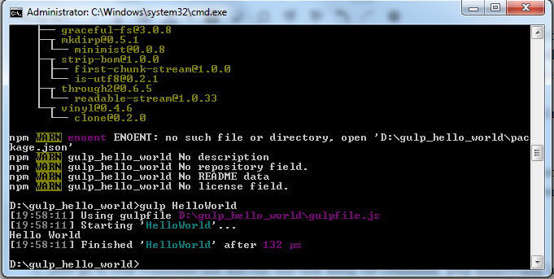

After I made my choice from the [Grunt Vs Gulp Vs npm](/development/web-development/javascript/grunt-vs-gulp-vs-npm/) confusion I had, Gulp turned out to be my task runner for a project. And in this post, I will explain what you get with it. The first thing you need to know is that gulp uses streams to process files. Think of it as a plumber, which plugs in pipelines in between the input (tap) and the output (destination). It process and examine your files, and it modifies them and can alter them to a new destination as well.



For using gulp, you need to know only 4 API’s

## gulp.task

This is used to create a task (which is essentially a function). You can also declare dependencies in this task if you want to do so (optional). You usually create a task for testing/code analysis, optimizing files (concatenating, minifying) and for running your application.

The syntax for creating a task is:

```javascript
gulp.task('task_name', [dependencies_list], function() {
 });
```

When you run a task which has multiple dependencies in the dependency list, they run in parallel before the task runs.

## gulp.src

This refers to the beginning stream for a particular task. It takes in a set of files as an input (also known as a glob) and an optional parameter which specifies the options. Globs are patterns in the form of wildcards such as \*.js. Usually the \* is the most used pattern, but if you are looking for something specific, you can find more details about glob from the [npm website](https://www.npmjs.com/package/glob). Another important scenario is if you wish to negate something, use the ! symbol in that case. gulp.src will emit all the files that match the  pattern. The syntax for gulp.src is

```javascript
gulp.src(pattern, options);
```

The options specify a variety of things. But the only useful one in my opinion is base. It can be used to default to how much of the path specified in the pattern you wish to keep while emitting out the file stream. So if I write gulp.src(‘app/js/\*.js’, {base: ‘app’}, the output will be in build/js/ instead of build/app/js/. That is the base part is trimmed from the destination path.

## gulp.dest

This refers to the destination where the files are to be written to. The syntax is similar to that of gulp.src:

```javascript
gulp.dest(folder,options);
```

The options here can be used to provide mode for file/folder permissions (octal representation, using options.mode. The default is 0777.) or change the current working directory (using options.cwd)

## gulp.watch

This allows us to watch the files and if they get modified, perform some tasks. The files to be watched are passed in the form of a glob. The syntax is:

```javascript
gulp.watch(files, options, tasks_list);
```

Instead of the tasks list, you can also pass in a callback function as well which takes an event parameter passed to it. The event parameter has a type (what happened, modified/added/removed) and a path (which file).

Although the above 4 are mentioned as the API’s that you need to know in order to use the task runner, but I believe you should also know about one more thing. And that is

## pipe

These are used to stream data for processing it. What this means is that you can perform multiple sub tasks in a task using pipes. They allow you to chain streams without the need of buffers. You essentially take an input using src, pipe it to multiple sub tasks and then output it to the target using dest.

## Putting it all together

```javascript
gulp.task('scripts', function() {
 return gulp
 .src('./js/*.js')
 .pipe(jshint())
 .dest('./build/js/');
 });
```

So this is what a very basic gulp task looks like. To try it out yourself,

1. Install node from the [node website](https://nodejs.org/en/download/) and that should also install npm (node package manager) on its own.  
   You might want to update npm though since it gets updated more often than node itself. To do that you can use “(sudo) npm install npm -g” on the command line. npm is used to get javascript packages that you can use for a project. In our case we need it to install gulp.
2. Next you need to install gulp globally so that you can use it anywhere you want. Use “npm install -g gulp”. -g is for installing globally.  
   If you get an error of network timeout or network connectivity issues on windows while installing, update the registry first using the command “npm config set registry <https://registry.npmjs.org/>” and then install gulp.
3. Installing gulp globally allows you to use it on the command line in any folder. But you also need to install it locally since you are also going to use it in a project. So create a new folder, and then type in the command “npm install –save-dev gulp”. This will install gulp as a development dependency.  
   There are 2 types of dependencies when using npm to install locally, dependencies and dev dependencies. The first one are ones that you require in your project, such as angular, jquery etc. and dev dependencies are ones that are only needed during the development phase eg gulp, karma, jshint etc. Hence you use “npm install –save” for dependencies and add the -dev to it if the dependency is a dev one.  
   All the local dependencies can be found in your project.json file of the folder that you will create and run this command in.
4. Now that you have everything set up, you can create a gulpfile.js in the directory and then inside it create your gulp tasks as the one I showed above. The gulp file acts as a manifest for all tasks that you define.
5. One more thing that you need to know is that you need to use require.js as well (a bit of node involvement here). So at the top of the gulpfile.js, you need to have a statement  
   var gulp = require(‘gulp’);  
   The keyword require is used to reference/import modules in node. So you need a reference in the gulpfile.js to be able to refer the gulp module.
6. After the require statement, you can go ahead and create your first gulp task. So for a very simple hello world gulp task, this is what your gulpfile.js will look like:  
   var gulp = require(‘gulp’);  
   gulp.task(‘HelloWorld’, function() {  
   console.log(‘Hello World’);  
   });
7. Now go to your command line and run this task using the command “gulp HelloWorld”and you will see the hello world output. So you just created your first gulp task and you can now play with many more\!

For a person who does not even know gulp, this been a very long article to know about a tons of things.  Do let me know what do you think about it, And happy automating\!
