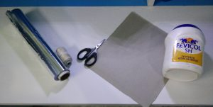
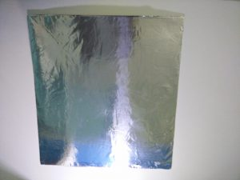
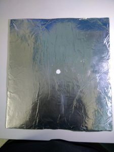
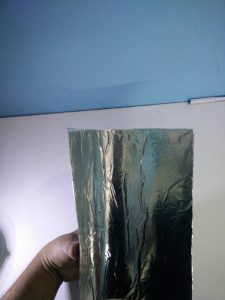
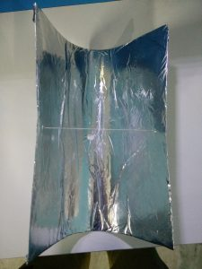
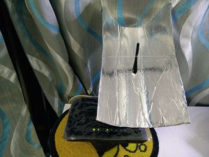
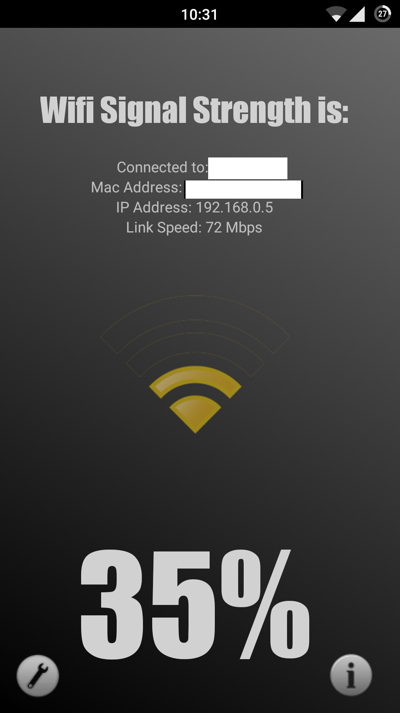
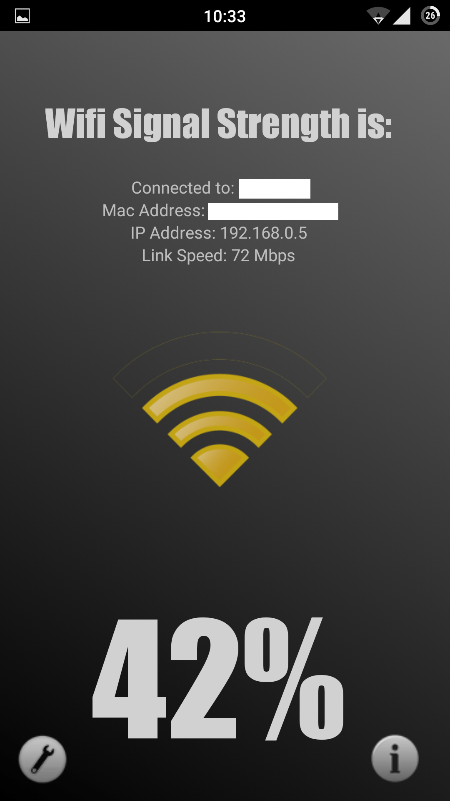

[![1280px-Wi-Fi\_Logo.svg\[1\]](./1280px-wi-fi-logo.svg1-.png)](./1280px-wi-fi-logo.svg1-.png)

One of the most frequent question asked when it comes to WiFi is if we can somehow extend the range of our router. You can purchase a repeater/ WiFi booster from the market to do the job if you wish to. But it is so much fun to do it yourself.

For those people who are unaware of a WiFi booster, it extends the range of your WiFi router to give you a relatively better signal strength.

### REQUIREMENTS

The following materials are required:

1. A Cardboard (No special kind but it must be easily foldable)
2. A Pair of scissors
3. Wrapping foil (Aluminum is suggested)
4. Any adhesive
5. Thread

### STEPS

1. Cut the cardboard into a square shape.
2. Paste the foil over the card board in such a manner that the cardboard is completely covered with foil on one side.
3. Wait for glue to dry, then make a whole exactly at the center of the card board.
4. now just fold the cardboard into an satellite like state and tie it with the thread using both the ends.
5. Place this folded cardboard over the antenna of your WIFI router.

This is the cheapest method out there but it is one that works! I have been personally using this for the past 6 months. It gives about a 10-12% boost to your WiFi strength. When I checked for the signal strength with and without the DIY method, here are the results, before applying:

After Applying:

You can also use a tin can or some other material to achieve the same and if you are still not satisfied, get a better router or buy a repeater.

If you have any other DIY techniques, or if you found this useful, let us know in comments\!
